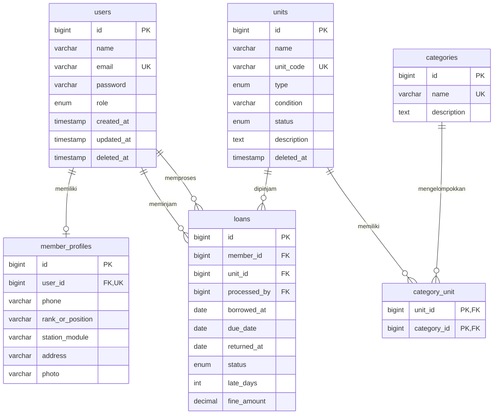

# StarDeck — Entity Relationship Document

Pasangan spesifikasi: `prd.md`. Acuan: ERD StarDeck yang telah diselaraskan dengan PRD(1). Enam tabel bisnis menggunakan MySQL InnoDB dan utf8mb4_unicode_ci. Nama tabel/kolom di bawah wajib konsisten di migration, model, request, service, view dan test.

## 1. Diagram relasi



Relasi users–profil secara umum 0..1 karena admin tidak wajib memiliki profil; setiap member WAJIB tepat satu profil. Diagram fisik mengizinkan pivot kosong, tetapi aplikasi wajib memastikan setiap unit memiliki minimal satu kategori. Dua relasi users–loans berbeda: member_id menunjuk peminjam, processed_by menunjuk admin pencatat peminjaman. Foreign key saja tidak memvalidasi role.

## 2. Kamus struktur inti

Blok SQL berikut mendefinisikan tipe, panjang, nullability, default, index dan foreign key secara presisi. Ini referensi untuk migration, BUKAN skrip yang perlu diimpor ke database proyek yang sudah berjalan.

```sql
CREATE TABLE users (
 id BIGINT UNSIGNED AUTO_INCREMENT PRIMARY KEY,
 name VARCHAR(100) NOT NULL,
 email VARCHAR(255) NOT NULL,
 password VARCHAR(255) NOT NULL,
 role ENUM('admin','member') NOT NULL DEFAULT 'member',
 created_at TIMESTAMP NULL DEFAULT NULL,
 updated_at TIMESTAMP NULL DEFAULT NULL,
 deleted_at TIMESTAMP NULL DEFAULT NULL,
 UNIQUE KEY uq_users_email (email)
) ENGINE=InnoDB DEFAULT CHARSET=utf8mb4 COLLATE=utf8mb4_unicode_ci;

CREATE TABLE member_profiles (
 id BIGINT UNSIGNED AUTO_INCREMENT PRIMARY KEY,
 user_id BIGINT UNSIGNED NOT NULL,
 phone VARCHAR(15) NOT NULL,
 rank_or_position VARCHAR(100) NOT NULL,
 station_module VARCHAR(100) NOT NULL,
 address VARCHAR(255) NULL,
 photo VARCHAR(255) NULL,
 UNIQUE KEY uq_profiles_user (user_id),
 CONSTRAINT fk_profiles_user FOREIGN KEY (user_id) REFERENCES users(id) ON DELETE CASCADE
) ENGINE=InnoDB DEFAULT CHARSET=utf8mb4 COLLATE=utf8mb4_unicode_ci;

CREATE TABLE categories (
 id BIGINT UNSIGNED AUTO_INCREMENT PRIMARY KEY,
 name VARCHAR(50) NOT NULL,
 description TEXT NULL,
 UNIQUE KEY uq_categories_name (name)
) ENGINE=InnoDB DEFAULT CHARSET=utf8mb4 COLLATE=utf8mb4_unicode_ci;

CREATE TABLE units (
 id BIGINT UNSIGNED AUTO_INCREMENT PRIMARY KEY,
 name VARCHAR(150) NOT NULL,
 unit_code VARCHAR(9) NOT NULL,
 type ENUM('board_game','console') NOT NULL,
 `condition` VARCHAR(100) NOT NULL,
 status ENUM('available','borrowed') NOT NULL DEFAULT 'available',
 description TEXT NULL,
 deleted_at TIMESTAMP NULL DEFAULT NULL,
 UNIQUE KEY uq_units_code (unit_code),
 KEY idx_units_name (name)
) ENGINE=InnoDB DEFAULT CHARSET=utf8mb4 COLLATE=utf8mb4_unicode_ci;

CREATE TABLE category_unit (
 unit_id BIGINT UNSIGNED NOT NULL,
 category_id BIGINT UNSIGNED NOT NULL,
 PRIMARY KEY (unit_id, category_id),
 CONSTRAINT fk_pivot_unit FOREIGN KEY (unit_id) REFERENCES units(id) ON DELETE CASCADE,
 CONSTRAINT fk_pivot_category FOREIGN KEY (category_id) REFERENCES categories(id) ON DELETE RESTRICT
) ENGINE=InnoDB DEFAULT CHARSET=utf8mb4 COLLATE=utf8mb4_unicode_ci;

CREATE TABLE loans (
 id BIGINT UNSIGNED AUTO_INCREMENT PRIMARY KEY,
 member_id BIGINT UNSIGNED NOT NULL,
 unit_id BIGINT UNSIGNED NOT NULL,
 processed_by BIGINT UNSIGNED NOT NULL,
 borrowed_at DATE NOT NULL,
 due_date DATE NOT NULL,
 returned_at DATE NULL,
 status ENUM('borrowed','returned') NOT NULL DEFAULT 'borrowed',
 late_days INT UNSIGNED NOT NULL DEFAULT 0,
 fine_amount DECIMAL(12,2) NOT NULL DEFAULT 0.00,
 KEY idx_loans_member_status (member_id, status),
 KEY idx_loans_unit_status (unit_id, status),
 CONSTRAINT fk_loans_member FOREIGN KEY (member_id) REFERENCES users(id) ON DELETE RESTRICT,
 CONSTRAINT fk_loans_unit FOREIGN KEY (unit_id) REFERENCES units(id) ON DELETE RESTRICT,
 CONSTRAINT fk_loans_admin FOREIGN KEY (processed_by) REFERENCES users(id) ON DELETE RESTRICT
) ENGINE=InnoDB DEFAULT CHARSET=utf8mb4 COLLATE=utf8mb4_unicode_ci;
```

## 3. Adaptasi Laravel yang sudah ada

Schema inti di atas menggunakan users.name VARCHAR(100). Migration Laravel pengguna saat ini membuat VARCHAR(255). Untuk database berjalan, pertahankan panjang 255 dan validasi aplikasi maksimal 100; ini pengecualian fisik yang disengaja agar tidak mengecilkan kolom berisi data. Instalasi baru melalui migration yang sama juga mengikuti 255. Jangan menyatakan kedua skema identik secara fisik.

Pertahankan kolom teknis bawaan users.email_verified_at (timestamp nullable) dan users.remember_token (varchar 100 nullable). Keduanya tidak mengubah kebutuhan bisnis; verifikasi email bukan fitur wajib. Pertahankan tabel infrastruktur Laravel yang sudah ada, misalnya migrations, sessions, password_reset_tokens, cache atau jobs. Enam tabel bisnis bukan berarti database harus hanya berisi enam tabel.

- Periksa migration tambahan role/deleted_at sebelum membuatnya; instruksi sebelumnya belum terbukti dijalankan.
- Bila migration sudah ada dan pending, isi/perbaiki migration tersebut. Bila sudah Ran, jangan membuat kolom yang sama lagi; bandingkan skema aktual dan buat migration koreksi hanya untuk gap nyata.
- Jangan memakai hasTable/hasColumn secara sembarang untuk menyembunyikan schema drift. Bila ditemukan tabel dari impor SQL tanpa riwayat migration, laporkan dan susun rekonsiliasi non-destruktif sebelum migrasi.
- Urutan pembuatan: users → penambahan role/deleted_at → member_profiles dan categories → units → category_unit → loans. Tanggal/nama migration harus menjamin dependensi FK.
- Rollback migration baru melepas tabel anak lebih dahulu. Jangan mengedit migration lama yang sudah dieksekusi.
- users dan units memakai SoftDeletes. users memakai timestamps bawaan. MemberProfile, Category, Unit dan Loan memakai `$timestamps = false`; pivot tidak memakai withTimestamps karena kolom tersebut tidak ada.
- Gunakan kolom condition lewat Schema Builder/Query Builder; jika menulis SQL mentah, kutip sebagai `condition`.

## 4. Relasi Eloquent

| Model | Relasi |
|---|---|
| User | memberProfile: hasOne(MemberProfile); loans: hasMany(Loan, member_id); processedLoans: hasMany(Loan, processed_by) |
| MemberProfile | user: belongsTo(User) |
| Category | units: belongsToMany(Unit, category_unit) |
| Unit | categories: belongsToMany(Category, category_unit); loans: hasMany(Loan) |
| Loan | member: belongsTo(User, member_id); unit: belongsTo(Unit); processedBy: belongsTo(User, processed_by) |

Gunakan withTrashed pada relasi historis Loan ke member/unit/admin agar soft delete tidak menghilangkan informasi riwayat. Jangan memakai withTrashed untuk pilihan member/unit peminjaman baru. Cast borrowed_at, due_date dan returned_at sebagai date; late_days integer, fine_amount decimal:2. Jangan menghitung uang dengan floating point; tarif kelipatan rupiah dapat dihitung sebagai integer lalu disimpan DECIMAL.

## 5. Integritas database dan aplikasi

| Aturan | Lapisan penjamin |
|---|---|
| Email, unit_code, nama kategori unik | Unique database + validasi server |
| Satu profil maksimal per user | Unique member_profiles.user_id |
| Setiap member wajib satu profil | Transaksi create user+profil dan validasi aplikasi |
| Pasangan unit–kategori tidak ganda | Primary key komposit pivot |
| Setiap unit minimal satu kategori | Validasi + transaksi update unit/pivot |
| Kategori terpakai tidak dapat dihapus | Foreign key RESTRICT + pesan aplikasi; cek seluruh pivot |
| Loan selalu merujuk user/unit valid | Foreign key RESTRICT |
| member_id harus member; processed_by harus admin | Otorisasi dan validasi aplikasi |
| Maksimal dua loan aktif/member | Transaksi + lock member + hitung ulang |
| Maksimal satu loan aktif/unit | Transaksi + lock unit + periksa loan aktif |
| Unit dan loan mempunyai status konsisten | Service transaksi, tidak dapat diubah lewat CRUD biasa |

FK CASCADE pada profil/pivot berlaku untuk hard delete; soft delete hanya mengisi deleted_at sehingga tidak menghapus profil/pivot. Hard delete user/unit bukan fitur aplikasi. Email/kode tetap reserved setelah soft delete.

Tidak ada unique biasa pada loans.unit_id karena akan melarang riwayat pinjaman berulang. Jangan membuat unique(unit_id,status): itu juga akan membatasi riwayat returned menjadi satu. Skema ini mengandalkan protokol locking yang wajib dipakai seluruh jalur penulisan loan, termasuk seed demo.

## 6. Protokol transaksi

Keputusan implementasi: jika operasi membutuhkan beberapa baris, urutan lock adalah member → unit → loan. Gunakan transaksi dan lockForUpdate. Jangan memakai urutan terbalik di operasi lain.

Peminjaman:
1. Lock member berdasarkan ID, pastikan belum soft deleted dan role member serta profil lengkap.
2. Lock unit, pastikan belum soft deleted dan available.
3. Periksa ulang jumlah loan borrowed member <2 dan tidak ada loan borrowed untuk unit. Gunakan pembacaan konsisten/current setelah lock; bila mengunci baris loan, lakukan pada tahap ini.
4. Insert loan dengan tanggal/status/nilai awal yang dihitung server lalu update unit borrowed; commit bersama.

Pengembalian:
1. Baca ID member dan unit dari loan sebagai petunjuk, bukan dasar keputusan final. ID ini tidak boleh diubah oleh fitur aplikasi.
2. Dalam transaksi lock member (termasuk data terhapus bila ada inkonsistensi historis), unit, kemudian loan; baca ulang dan validasi hubungan/status borrowed.
3. Hitung tanggal kembali hari ini, selisih hari kalender non-negatif dan denda. Update loan returned dan unit available; commit bersama.
4. Request kedua akan melihat loan returned lalu ditolak tanpa perubahan.

Penghapusan member: lock member lalu periksa loan borrowed; tolak jika ada, selain itu soft delete. Penghapusan unit: lock unit lalu periksa loan borrowed; tolak jika ada, selain itu soft delete. Jangan mengambil lock member setelah memegang lock unit. Validasi penolakan harus membatalkan seluruh transaksi.

Unit CRUD tidak boleh mengubah status manual. Penghapusan kategori mengandalkan RESTRICT untuk menahan kondisi balapan dengan penambahan pivot; ubah pelanggaran constraint menjadi pesan yang dapat dipahami. Tangani deadlock/konflik dengan rollback dan retry terbatas bila sesuai, bukan mengabaikan error.

## 7. Nilai dan invariants

- Role: admin/member; default member.
- Tipe: board_game/console. Prefix BG/CN harus cocok, kode tepat 9 karakter.
- Status unit: available/borrowed. Status loan: borrowed/returned.
- Loan borrowed: returned_at NULL, late_days 0, fine_amount 0; nilai nol tersebut bukan denda final.
- Loan returned: returned_at terisi, returned_at >= borrowed_at, late_days >=0, fine_amount = late_days ×5000.
- due_date selalu borrowed_at +5 hari kalender.
- Jangan menambah status overdue; derive dari loan aktif dan due_date <today.
- processed_by tetap admin peminjaman, bukan admin pengembalian.
- Deskripsi nullable; phone disimpan VARCHAR supaya nol awal tidak hilang.
- Index units.name membantu sebagian pola pencarian, tetapi tidak menjamin pencarian LIKE '%kata%' memakai index. Ukur performa dengan data demo.

## 8. Verifikasi

Periksa migration pada DB pengujian MySQL terpisah, struktur tabel/FK/index, relasi Eloquent dan ketepatan soft delete. Jalankan skenario AC di prd.md, termasuk race condition dan rollback. Jangan menjalankan test dengan RefreshDatabase pada database pengguna. Dokumen ini spesifikasi; belum membuktikan implementasi atau hasil test aktual.
